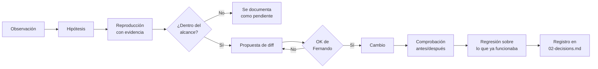

# Método de trabajo

Este documento rige todas las sesiones de trabajo del reto. Se importa desde `CLAUDE.md`, por lo que cada sesión nueva lo carga automáticamente.

## Tesis

> Un asistente de IA en un banco no falla por falta de inteligencia. Falla cuando afirma cosas que no puede verificar.

Todo lo que entregamos debe aumentar la confianza verificable: del cliente en el asistente, del operador en el historial y del revisor en nuestra entrega.

## Roles

- **Fernando (tech lead):** decide, prioriza y verifica.
- **Asistente de IA:** investiga e implementa bajo su dirección. No toma decisiones de alcance por su cuenta.

## Modelos mentales y dónde se aplican

| Modelo | Idea | Aplicación en este reto |
|---|---|---|
| Inversión («invertir, siempre invertir», Jacobi, tal como lo usa Munger) | Se llega antes a la solución preguntando cómo fracasar. | El diagnóstico parte de una pregunta: ¿cómo haríamos que un cliente perdiera la confianza en Banana Bank el lunes? |
| Checklist (Munger, aviación) | Lo crítico no se confía a la memoria. | Cada regla de negocio de `docs/contracts.md` se convierte en una casilla verificada con evidencia. Cerramos con un checklist Go/No-Go. |
| Margen de seguridad | Ante la incertidumbre, se elige el error menos costoso. | Con timeouts o evidencia ausente, el sistema nunca afirma lo que no puede verificar. |
| Círculo de competencia | Se actúa solo dentro de lo que se domina. | Solo corregimos lo que podemos verificar. Los hallazgos fuera de alcance se documentan, no se ocultan. |
| Pensamiento de segundo orden | «¿Y después qué?» | Cada corrección se prueba también contra lo que ya funcionaba. |
| Efecto lollapalooza | Varias fuerzas alineadas se multiplican. | Diagnóstico, correcciones, funcionalidad y traspaso refuerzan la misma tesis. |

## Protocolo de trabajo

Válido para todas las sesiones.

1. **Solo lectura** hasta que Fernando apruebe un cambio.
2. Antes de modificar cualquier archivo, se muestra el diff y se espera un **OK explícito**.
3. **Nunca se modifica `simulator/`** (es el banco externo) ni se desactivan sus escenarios.
4. **Toda afirmación requiere evidencia:** `archivo:línea`, una reproducción con los escenarios del simulador o un test.
5. **Toda corrección lleva una comprobación antes/después reproducible.**
6. **Nunca se abre, lee ni imprime `.env.local`** ni ningún otro secreto.
7. **Toda decisión se registra en `submission/02-decisions.md`:** qué elegimos, qué descartamos y por qué.

## Ciclo de trabajo

## Mapa de documentación

Los diagramas se escriben en Mermaid.

| Ruta | Contenido |
|---|---|
| `submission/README.md` | Índice, cómo ejecutar el proyecto, qué está terminado y qué queda pendiente. Se rellena la plantilla existente del reto, no se sustituye. |
| `submission/00-method.md` | Este documento. |
| `submission/01-diagnosis.md` | Diagnóstico: hallazgos reproducidos y priorizados. |
| `submission/02-decisions.md` | Registro de decisiones. |
| `submission/03-fixes/` | Un archivo por corrección, con evidencia antes/después. |
| `submission/04-feature.md` | Funcionalidad de la Parte 2. |
| `submission/05-security-audit.md` | Auditoría de seguridad, de solo lectura. |
| `submission/06-go-no-go.md` | Decisión final Go/No-Go y condiciones para producción. |
| `submission/07-recorrido-visual.md` | Recorrido visual: el trabajo entero en capturas, para leer primero. |
| `submission/notes/` | Notas de trabajo y observaciones sin verificar. |
| `submission/ai-sessions/` | Sesiones de IA completas, en su exportación original. |
| `submission/demo.mp4` | Vídeo de demostración de ambas partes. Se graba al final. |

## Idioma

La documentación de `submission/` se escribe en español neutro y profesional (España), con formato numérico español (2.400 y 15,25). El código, los identificadores, los nombres de archivo y los mensajes de commit se escriben en inglés.
