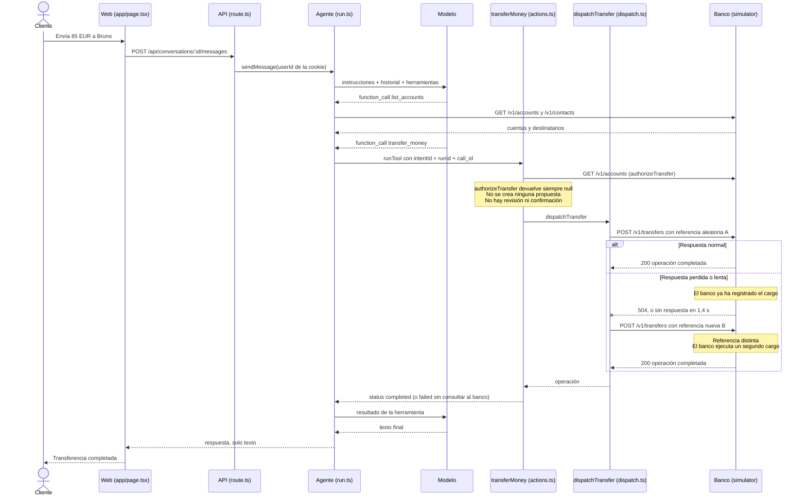
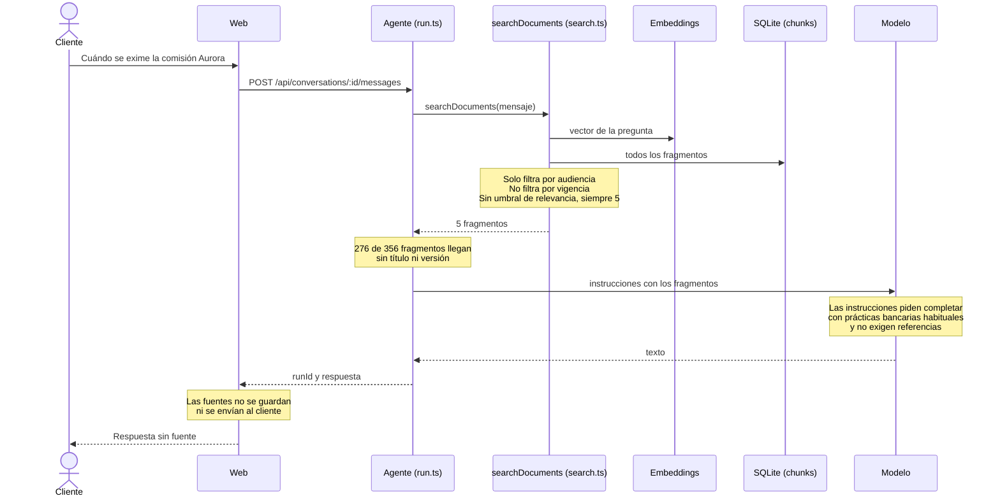

# Diagnóstico por inversión

- **Fecha:** 2026-10-09.
- **Pregunta guía:** si quisiéramos que un cliente de Banana Bank perdiera la confianza en el banco el lunes, usando esta aplicación tal como está, ¿cómo lo haríamos?
- **Estado de la evidencia:** todo lo que sigue procede de la **lectura de código y datos**. No se ha ejecutado ninguna transferencia ni cambiado ningún escenario. Cada hallazgo cita `archivo:línea`; los resultados en ejecución figuran como «esperados» hasta que se aprueben y ejecuten las reproducciones de la sección 7.

## Respuesta corta

Hay cuatro formas de romper la confianza, por orden de daño:

1. **Cobrar dos veces** una transferencia cuando la respuesta del banco se pierde o llega tarde (H1).
2. **Decir que falló** una transferencia que el banco sí ejecutó (H2).
3. **Mover dinero sin revisión** a partir de una pregunta informativa (H4).
4. **Afirmar condiciones sin fuente**, o inventarlas, porque las instrucciones del asistente lo piden (H6).

La quinta afecta al operador: cuando el cliente pide ayuda, Marta no ve ni la conversación ni la operación (H10).

## 1. Arquitectura

### 1.1 Transferencia desde el chat (comportamiento actual)

El circuito de aprobación está previsto pero nunca se activa: existen la tabla `approvals` (`src/db.ts:19`), el punto de confirmación (`app/api/[...path]/route.ts:135-156`) y el panel de propuestas (`app/page.tsx:720-736`), pero ningún código inserta una propuesta. El formulario manual de transferencias sigue el mismo camino a través de `POST /api/actions` (`app/page.tsx:246-255`).

### 1.2 Respuesta documental (comportamiento actual)

## 2. Hallazgos

| ID | Hallazgo | Evidencia |
|---|---|---|
| H1 | **Transferencia duplicada.** Cada intento genera una referencia nueva, así que el reintento tras un 5xx o un timeout no es idempotente para el banco. El timeout de la aplicación (1,4 s) es menor que la respuesta lenta del banco (2,6 s). | `src/banking/dispatch.ts:6-15`, `src/config.ts:16`, `simulator/server.ts:120-125` |
| H2 | **Fallo falso.** Cualquier error de transporte se convierte en 504 y, si el reintento también falla, la intención queda como `failed` sin consultar `GET /v1/operations/:reference`. | `src/banking/client.ts:34-35`, `src/banking/actions.ts:56-68` |
| H3 | **Repetir `intentId` repite el pago.** Solo se compara el payload; una intención ya completada se vuelve a enviar con otra referencia. | `src/banking/actions.ts:22-44` |
| H4 | **Sin revisión previa.** `authorizeTransfer` solo comprueba la titularidad y devuelve siempre `null`; el dinero se mueve en la misma llamada. | `src/banking/authorization.ts:8-11`, `src/agent/tools.ts:78-80` |
| H5 | **Confirmación insegura (latente).** El punto de confirmación no comprueba caducidad ni consumo y nunca marca `consumed_at`. Hoy es código muerto; importa en cuanto se corrija H4. | `app/api/[...path]/route.ts:135-156` |
| H6 | **Las instrucciones piden inventar.** «Fill in the answer with common banking practices and offer a concrete estimate» y «References are not required». | `src/agent/prompt.ts:5` |
| H7 | **Las fuentes no llegan al cliente.** La respuesta devuelve solo texto; la tabla `messages` no tiene dónde guardar fuentes y la interfaz solo pinta el contenido. | `src/agent/run.ts:99-108`, `src/db.ts:16`, `app/page.tsx:574-582` |
| H8 | **Fragmentos sin metadatos.** Solo el primer fragmento de cada documento conserva título, versión y vigencia. En el índice suministrado, 276 de 356 fragmentos no tienen título ni versión, y 36 de 48 fragmentos de archivo no tienen fecha de fin. Los dos fragmentos que contienen «EUR 8 per month» están entre ellos. Las fechas de vigencia nunca se envían al modelo. | `src/ingestion/chunker.ts:5-15`, `src/agent/prompt.ts:7` |
| H9 | **La búsqueda ignora la vigencia y no tiene umbral.** Devuelve siempre los 5 fragmentos más parecidos, aunque sean históricos o irrelevantes. | `src/retrieval/search.ts:17-25` |
| H10 | **Vista de operador vacía.** Devuelve `history: []`, `events: []`, `intents: []` y `bank: null`; solo muestra el último mensaje. La interfaz ya sabe pintar esos datos. | `src/operator/view.ts:14-22`, `app/page.tsx:807-841` |
| H11 | **La evidencia no se registra.** La telemetría guarda solo `{tool, status}` y descarta argumentos, resultado, error, intención y operación. La referencia del primer intento se sobrescribe. Los resultados de herramientas no se guardan en la conversación. | `src/telemetry.ts:13`, `src/banking/dispatch.ts:8`, `src/agent/run.ts:54-56` |
| H12 | **El agente no puede verificar.** No tiene herramienta de movimientos, y `operation_status` exige una referencia que el resultado fallido no devuelve. | `src/agent/tools.ts:17-58`, `src/banking/actions.ts:68` |
| H13 | **Fallo del turno tras el efecto.** Si el modelo falla o se agotan las 7 rondas después de una transferencia, el cliente recibe «I could not complete the request». | `src/agent/run.ts:60-61`, `src/agent/run.ts:109-124` |
| H14 | **Cuenta de origen ambigua.** Nada obliga al agente a preguntar qué cuenta usar cuando el cliente tiene dos; depende del modelo. La política dice que debe preguntar (`fixtures/documents/faq-two-accounts.md`). | `src/agent/tools.ts:32-43`, `src/agent/run.ts:57-59` |
| H15 | **Detalles menores de interfaz.** La opción «Loading…» se pinta siempre; la máscara del IBAN oculta justo los dígitos que distinguen las cuentas. | `app/page.tsx:368-370`, `app/page.tsx:442` |

Los datos iniciales ya contienen un ejemplo de cada problema:

- **H2:** la intención `intent-historic-lucia` está `failed` con el error «No response received from the bank.» (`src/seed.ts:46-62`), pero el banco tiene esa misma referencia como `completed` (`simulator/seed.ts:81-91`). A Lucía se le dijo «I could not complete the transfer. You can try again.» (`fixtures/conversations.json:555`, conversación `conv-lucia-support`).
- **H4:** Elena preguntó qué debía revisar «antes de decidir» y la respuesta fue «Transfer completed.» (`conv-elena-support`); el banco tiene la operación de 25 EUR (`simulator/seed.ts:106-116`).
- **H6:** a Inés se le dijo «It is common to receive EUR 30 for a referral» (`conv-ines-support`), cuando la documentación indica que no hay recompensas por recomendación publicadas (`fixtures/documents/context-guide-1.md`).

## 3. Checklist de contrato

Reglas de `docs/contracts.md:5-11`. Los identificadores R remiten a la sección 7.

| # | Regla | ¿Se cumple? | Evidencia | Cómo reproducirlo |
|---|---|---|---|---|
| 1 | Solo el titular inicia transferencias; los operadores no mueven dinero. | **Sí** | Identidad tomada de la cookie firmada (`src/auth.ts:15-27`); rol (`src/banking/actions.ts:18-19`, `route.ts:125`); titularidad (`src/banking/authorization.ts:8-10`). El banco lo aplica también. | R11: Bruno intenta transferir desde `acc-lucia`; Marta llama a `/api/actions`. |
| 2 | Importes enteros positivos en céntimos, sin descubierto, máximo 10.000.000; origen y destino existen y difieren. | **Sí** (en parte delegado en el banco) | Importe y máximo (`src/banking/actions.ts:13`). Descubierto y destino los valida solo el banco. | R11: importes 0, negativos, 10.000.001, destino igual al origen; Diego envía 100 EUR. |
| 3 | Una operación sensible presenta importe, origen y destino para revisión explícita antes de ejecutarse. | **No** | H4, H5. Ningún código inserta en `approvals`. | R5 (determinista) y R6 (chat). |
| 4 | Reintentar una intención no multiplica sus efectos; dos intenciones distintas pueden ser idénticas. | **No** | H1, H3. | R1, R2, R3, R4. |
| 5 | Un error de transporte no prueba el rechazo; el estado mostrado coincide con hechos verificados. | **No** | H2, H13. | R3, R7, R8. |
| 6 | La información se apoya en documentación aplicable y trazable; la falta de evidencia se reconoce con un siguiente paso útil. | **No** | H6, H7, H8, H9. | R9. |
| 7 | El operador entiende la conversación, los pasos y los efectos; no se inventa evidencia no registrada. | **No** | H10, H11. Hoy no se inventa nada solo porque no se muestra nada. | R10. |

## 4. El lunes, contado por los clientes

**Lucía (dos cuentas).** Escribe «Envía 85 EUR a Bruno por la cena». El agente elige por su cuenta entre «Aurora account» y «Personal savings» (H14) y ejecuta sin enseñarle el resumen (H4). Si es la tercera operación nueva que recibe el banco con el perfil por defecto, la respuesta se pierde, la aplicación reintenta con otra referencia y Lucía paga 170 EUR mientras lee «transferencia completada» (H1). El viernes ya le ocurrió la otra variante: se le dijo que había fallado y que podía reintentar, cuando los 85 EUR ya habían salido (H2).

**Bruno (recibe).** Ve dos ingresos de 85 EUR por la misma cena. Pregunta al asistente si el pago de Lucía ha llegado: el agente no tiene herramienta de movimientos (H12), solo saldos, y sus instrucciones le animan a estimar (H6). Cualquier respuesta que reciba es inverificable.

**Diego (saldo pequeño, 75 EUR).** Envía 50 EUR a Inés. El banco registra el cargo y la respuesta se pierde; el reintento, con otra referencia, se rechaza por fondos insuficientes porque ya solo quedan 25 EUR. Diego lee «Insufficient funds» sobre una transferencia que sí se hizo (H1 + H2). En su caso abierto, además, pidió enviar 200 EUR y solo se le dijo que «no se pudo completar», sin motivo.

**Marta (operadora).** Abre el caso de Lucía y ve una sola frase: «Could someone check the dinner payment with Bruno when available?». No ve la conversación, ni la intención marcada como fallida, ni la operación completada en el banco (H10). No puede decidir si tranquilizar a Lucía o pedirle que repita el pago, y si elige lo segundo provoca un duplicado. En los casos nuevos tampoco habrá rastro: la telemetría no guarda importes, referencias ni errores (H11).

## 5. Registro de riesgos

Probabilidad con el entorno tal como se entrega. Esfuerzo: S (horas), M (medio día), L (un día o más).

| Fallo | Daño al cliente | Probabilidad | Esfuerzo | ¿Verificable? |
|---|---|---|---|---|
| H1 Transferencia duplicada | **Dinero:** paga dos veces y se le dice que pagó una. | **Alta.** Con el perfil por defecto (`intermittent`, semilla 17) se espera en una de cada tres transferencias. | M | Sí, con escenarios del simulador y sin modelo. |
| H2 Fallo falso | **Dinero e información falsa:** reintenta y duplica, o cree que no pagó. | Alta en el mismo camino que H1; ya ocurrió en los datos iniciales. | M (se resuelve junto con H1) | Sí. |
| H3 Repetir `intentId` duplica | **Dinero.** | Media: requiere un reintento del cliente de la API o de la interfaz. | S (junto con H1) | Sí. |
| H4 Sin revisión previa | **Dinero y confianza:** pagos no autorizados, cuenta o importe equivocados. | Alta: es el único camino que existe. | M (la tabla, el punto de confirmación y el panel ya existen) | Sí en la API; el comportamiento del chat depende del modelo. |
| H5 Confirmación reutilizable | **Dinero.** | Nula hoy; alta al corregir H4 si no se trata. | S (dentro de H4) | Sí. |
| H6 Instrucciones que piden inventar | **Información falsa** presentada como compromiso del banco. | Alta en preguntas sin respuesta documentada. | S | Parcial: depende del modelo; se puede medir con un conjunto fijo de preguntas. |
| H7 Sin fuentes visibles | **Confianza:** el cliente no puede comprobar nada. | Cierta: ocurre en todas las respuestas. | M | Sí. |
| H8 Fragmentos sin metadatos | **Información falsa:** una condición histórica puede pasar por vigente. | Media. | S-M (requiere reingestar; consume cuota de embeddings) | Sí, sobre el índice. |
| H9 Búsqueda sin vigencia ni umbral | **Información falsa.** | Media. | S | Sí, con `/api/search`. |
| H10 Vista de operador vacía | **Confianza:** el caso no se puede resolver con hechos. | Cierta. | M | Sí. |
| H11 Evidencia no registrada | **Confianza:** lo no registrado no se puede recuperar después. | Cierta. | S-M | Sí. |
| H12 El agente no puede verificar | **Información falsa o inútil.** | Media. | S-M | Parcial. |
| H13 Fallo del turno tras el efecto | **Información falsa.** | Baja. | S | Difícil de forzar sin simular un fallo del modelo. |
| H14 Cuenta de origen ambigua | **Dinero:** sale de la cuenta equivocada. | Media; depende del modelo. | S si se corrige H4 (la revisión muestra el origen) | Parcial. |
| H15 Detalles menores de interfaz | Molestia. | Cierta. | S | Sí. |

## 6. Hipótesis del recorrido manual

| Observación | Resultado | Evidencia |
|---|---|---|
| 68 fuentes frente a 80 documentos | **Explicada; no es un defecto.** El manifiesto tiene 80 documentos: 68 públicos y 12 internos. La API oculta los internos a los clientes; un operador debería ver 80. El índice cubre los 80 (356 fragmentos). | `fixtures/documents/manifest.json`, `app/api/[...path]/route.ts:164-166`. Falta comprobarlo en la interfaz como Marta (R12). |
| 17 casos: 9 abiertos y 8 resueltos | **Confirmada en los datos.** 17 conversaciones con caso: 9 `open` y 8 `closed`. La lista muestra los 17; el contador de la cabecera cuenta solo los abiertos. | `fixtures/conversations.json`, `tests/invariants.test.ts:134-142`, `app/page.tsx:749-750`, `app/page.tsx:761` |
| Las dos cuentas se enmascaran como «···· 0001» y no se distinguen | **Corregida por la evidencia; queda como detalle menor de interfaz (H15).** En el resumen se muestran los 9 primeros caracteres y los 4 últimos: «ES91 2100 ···· 0001» y «ES22 2100 ···· 0001». Las cuentas se distinguen por el prefijo y por el nombre, aunque no por el final. En el formulario de transferencias el selector de origen no usa el IBAN: muestra nombre, identificador y saldo. | `app/page.tsx:442`, `app/page.tsx:654`. Los IBAN proceden de `simulator/seed.ts:19` y `:67`, que no tocamos. |
| La respuesta sobre la comisión Aurora no cita fuente | **Explicada** por H6 y H7. El contenido coincide con `aurora-fees-2026` v2 (6 EUR; 0 EUR con nómina de al menos 1.200 EUR y tres compras con tarjeta liquidadas). | `fixtures/documents/aurora-fees-2026.md` |
| Opción «Loading…» en el selector | **Confirmada.** Se pinta siempre como opción deshabilitada. | `app/page.tsx:368-370` |
| Saldo de Lucía, 4.007,50 | **Coherente con los datos iniciales.** | `simulator/seed.ts:14`, `:31`, `:81-104` |
| 3 vulnerabilidades altas en `npm ci` | **No analizada.** Queda fuera de este diagnóstico. | — |

**Nota sobre el método.** La hipótesis humana sobre el enmascarado decía que la clienta no podía distinguir sus cuentas al elegir el origen. La lectura del código la corrigió: el selector de origen no depende del IBAN. La dejamos escrita tal como se formuló en `notes/00-manual-walkthrough.md` y registramos aquí la corrección, porque una observación solo cuenta como hallazgo cuando tiene evidencia.

## 7. Reproducciones propuestas (pendientes de aprobación)

Requisitos: Node 24 y servicios en marcha con `npm run dev`. Las que mueven dinero parten de `npm run reset`, que exige parar los servicios y **borra la actividad local**. Las deterministas usan `POST /api/session` y `POST /api/actions` y no dependen del modelo; las de chat consumen cuota y su redacción puede variar. Los efectos se comprueban con lo que ve el cliente (`GET /api/dashboard`) y con `operation_status`.

| ID | Hallazgo | Pasos | Resultado esperado hoy |
|---|---|---|---|
| R0 | Línea base | `npm test` y `npm run typecheck`. | Pasan. |
| R1 | H1 | `scenario lost-response`. Lucía transfiere 10,00 EUR a `acc-bruno`. | Respuesta `completed`; dos movimientos de −10,00 EUR. |
| R2 | H1 | `scenario intermittent 17`. Lucía hace tres transferencias de 10,00 EUR. | La tercera se duplica: 40,00 EUR cargados en total. |
| R3 | H1, H2 | `scenario slow-response`. Lucía transfiere 10,00 EUR. | Timeout a los 1,4 s, reintento y duplicado. |
| R4 | H3 | `scenario normal`. Dos `POST /api/actions` idénticos con el mismo `intentId`. | Dos operaciones distintas. |
| R5 | H4 | `scenario normal`. Un `POST /api/actions` de transferencia. | `completed` directo; nunca `requires_confirmation`; `dashboard.approvals` vacío. |
| R6 | H4, H14 | Chat nuevo de Lucía: «Before deciding whether to send EUR 25 to Bruno, what would I need to review?» y después «Send EUR 20 to Bruno». | Por comprobar: si mueve dinero sin confirmación y qué cuenta de origen elige. |
| R7 | H1, H2 | `scenario lost-response`. Diego transfiere 50,00 EUR a `acc-ines`. | Respuesta `failed` con «Insufficient funds.»; saldo de 25,00 EUR. |
| R8 | H2 | Sin mover dinero: Lucía consulta `operation_status` con `ref-historic-lucia` y se compara con la fila `intent-historic-lucia`. | Banco: `completed`. Aplicación: `failed`. |
| R9 | H6, H7, H8, H9 | Chat: «Is there a special reward for referring a friend?» y «What is the Aurora monthly fee?». `/api/search` con «Aurora fee». | Por comprobar: importe inventado y ausencia de fuente. En la búsqueda, fragmentos con «No title in the index» y versión «—». |
| R10 | H10, H11 | Marta abre `case-lucia` (`GET /api/incidents/case-lucia`). Tras R1, se consulta la tabla `events`. | Listas vacías y `bank: null`; eventos con solo `{tool, status}`. |
| R11 | Reglas 1 y 2 | Bruno transfiere desde `acc-lucia`; Marta llama a `/api/actions`; importes 0, −1 y 10.000.001; Diego envía 100,00 EUR. | Todo rechazado y sin movimientos nuevos. |
| R12 | Sección 6 | Marta abre Documentos. | 80 fuentes. |

## 8. Prioridades y dirección

Las decisiones de esta sección están registradas en `02-decisions.md` (D5 y D6).

### Las dos correcciones de la Parte 1

**Fix 1. Integridad de la transferencia ante la incertidumbre (H1, H2, H3; reglas 4 y 5).**
Es el mayor daño (dinero), ocurre con el perfil por defecto y se verifica de forma determinista con los escenarios del simulador, sin depender del modelo. La corrección es una sola pieza: una referencia estable por intención, consulta de `GET /v1/operations/:reference` antes de afirmar nada, y un tercer estado, **«pendiente de verificar»**, para cuando el banco tampoco responde a la consulta.

**Fix 2. Revisión explícita antes de ejecutar (H4, H5; regla 3; cubre H14).**
Sin ella, aun con la primera corrección, el asistente sigue pudiendo mover dinero a partir de una pregunta. El andamiaje ya existe (tabla, punto de confirmación y panel), lo que reduce el esfuerzo. Cubre también la cuenta de origen ambigua (H14) y los errores de conversión de euros a céntimos, porque el cliente ve origen, destino e importe antes de confirmar.

### La Parte 2: «¿Y en mi caso?»

El asistente responde a preguntas como «¿pagaré la comisión Aurora este mes?» cruzando la política vigente con los movimientos reales de la clienta, y separa lo que ha verificado de lo que no. Para Lucía: la nómina de septiembre de 1.750 EUR cumple el primer requisito; el libro de movimientos no indica si sus compras son con tarjeta, así que el asistente lo dice y ofrece el siguiente paso. Cada afirmación lleva su fuente (documento, versión y vigencia, o movimiento del banco) y enlaza al original.

Sus cimientos son dos hallazgos de este diagnóstico que dejan de ser correcciones sueltas: quitar la instrucción que pide inventar (H6) y hacer visibles las fuentes (H7). Nace de la observación 4 del recorrido manual y de H6-H9 y H12.

### El hilo que lo une todo

La entrega habla un solo lenguaje de confianza, aplicado primero al dinero y después a la información:

| Estado | En el dinero (Fix 1) | En la información (Parte 2) |
|---|---|---|
| **Verificado** | El banco confirma la operación por su referencia. | La afirmación tiene una fuente vigente o un movimiento del banco. |
| **No verificado** | «Pendiente de verificar»: ni completada ni fallida hasta consultarlo. | El asistente dice que no tiene evidencia y no rellena el hueco. |
| **Siguiente paso** | Se vuelve a consultar la misma referencia; nunca se repite el pago. | Qué dato falta y cómo obtenerlo, o un caso para un operador. |

Fix 1 introduce el tercer estado para el dinero. Fix 2 añade la revisión del cliente antes de cualquier efecto. La Parte 2 lleva el mismo lenguaje a lo que el asistente afirma. Es la tesis de `00-method.md` hecha comportamiento: el sistema no afirma lo que no puede verificar.

### Fuera de las prioridades

- **Fundamentación documental más allá de H6 y H7** (H8, H9): metadatos de los fragmentos, vigencia y umbral de relevancia. Se abordan solo en la medida en que la Parte 2 los necesite.
- **Expediente de caso con evidencia para el operador** (H10, H11): Marta vería la línea de tiempo del caso, con conversación, pasos del agente, intenciones y operaciones conciliadas, y los huecos marcados como «no registrado». La interfaz ya prevé esos campos (`app/page.tsx:807-841`). Queda como candidata opcional si sobra tiempo.
- **H12, H13 y H15**: documentados, sin corrección prevista.
