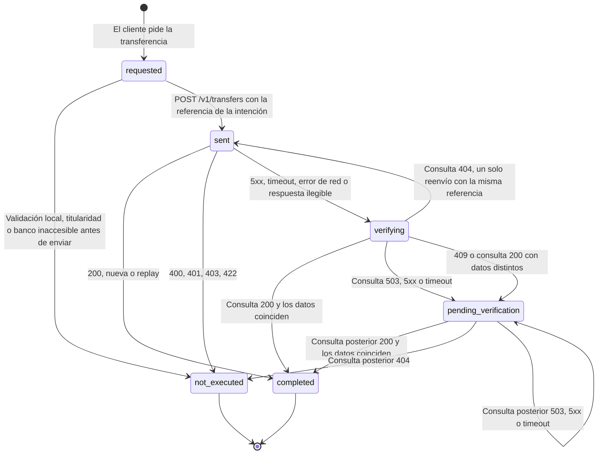

# Fix 1. Integridad de la transferencia ante la incertidumbre

- **Estado:** diseño aprobado. Implementación en tres partes: (a), (b) y (c).
- **Hallazgos que corrige:** H1, H2 y H3 de `01-diagnosis.md` (reglas 4 y 5 del contrato).
- **Evidencia «antes»:** `evidence/baseline.md` (R1, R2, R3, R4, R7, R8 y R13 no cumplen).
- **Regla de diseño:** solo un hecho verificado en el banco produce «completada» o «no ejecutada». La incertidumbre produce siempre «pendiente de verificar», nunca «fallida».

## 1. Estados de una intención de transferencia

`requested`, `sent` y `verifying` son estados de paso dentro de una misma acción del cliente. Los tres estados que el cliente llega a ver son `completed`, `not_executed` y `pending_verification`.

En la respuesta de la API, `not_executed` conserva el valor `failed` que ya existía, reservado ahora para «no ejecutada» verificada, y el estado pendiente usa el valor nuevo `pending_verification`. El texto que lee el cliente nunca dice «failed».

### Qué respuesta del banco lleva a cada estado

| Momento | Respuesta del banco | Qué sabemos | Estado |
|---|---|---|---|
| Antes de enviar | Fallo al comprobar las cuentas (5xx o timeout) | No hemos enviado nada. | `not_executed` |
| Envío | 200 (`replay` verdadero o falso) | El banco la ejecutó una vez. | `completed` |
| Envío | 422 | Fondos insuficientes; sin efecto. | `not_executed` |
| Envío | 400, 401, 403 | El banco no la aceptó; sin efecto. | `not_executed` |
| Envío | 409 | La referencia existe con otros datos. No debería ocurrir: es una anomalía. | `pending_verification` y revisión humana |
| Envío | 5xx, timeout, error de red, respuesta ilegible | **Nada.** Puede haberse ejecutado. | `verifying`: se consulta |
| Consulta | 200 y los datos coinciden | El banco la tiene registrada. | `completed` |
| Consulta | 200 y los datos no coinciden | Anomalía. | `pending_verification` y revisión humana |
| Consulta inmediata | 404 | El banco no la tiene. Reenviar con la misma referencia es seguro. | Un solo reenvío |
| Consulta inmediata | 503, 5xx o timeout | **Nada.** | `pending_verification` |
| Consulta posterior | 404 | El banco no la registró. No se reenvía: ha pasado tiempo y haría falta un consentimiento nuevo. | `not_executed` |

Una consulta cuenta como «posterior» cuando han pasado al menos 30 segundos desde que se creó la intención. Antes de ese margen el banco podría estar aún procesando el envío, así que un 404 deja la intención en `pending_verification`.

Tres decisiones de este diseño:

- **Una referencia por intención, para siempre.** Se genera al crear la intención y nunca se sobrescribe. El banco garantiza la idempotencia por actor y referencia (`docs/contracts.md:35`), así que el reenvío deja de poder duplicar.
- **Primero consultar, después reenviar.** Es lo que dice la política del propio banco: «Query the operation using its reference before repeating the attempt» (`fixtures/documents/faq-lost-response.md`). Si la consulta tampoco responde, la aplicación se detiene y dice que no lo sabe (margen de seguridad).
- **Como mucho un reenvío por acción del cliente.** En el peor caso son cuatro llamadas al banco, unos 5,6 s con el timeout actual de 1,4 s.

### Cómo se comporta en cada escenario del simulador

| Escenario | Secuencia | Estado final | Cargos |
|---|---|---|---|
| `normal` | Envío 200 | `completed` | 1 |
| `lost-response`, `intermittent` | Envío 504 → consulta 200 | `completed` | 1 |
| `slow-response` | Envío sin respuesta en 1,4 s → consulta 200 | `completed` | 1 |
| `reject-before` | Envío 503 → consulta 404 → reenvío 200 | `completed` | 1 |
| `read-unavailable` | Envío 504 → consulta 503 | `pending_verification`; la siguiente consulta la resuelve como `completed` | 1 |

## 2. Lo que lee el cliente

En el formulario de transferencias el texto se muestra tal cual. En el chat lo redacta el modelo a partir del resultado de la herramienta, que incluirá este mensaje; ahí la redacción exacta no se puede garantizar, solo comprobar.

| Estado | Mensaje (inglés, idioma de la aplicación) | Traducción |
|---|---|---|
| `completed` | Your transfer of {amount} to {recipient} is complete. The bank has confirmed it. Reference: {reference}. | Tu transferencia de {importe} a {destinatario} está completada. El banco la ha confirmado. Referencia: {referencia}. |
| `not_executed` (fondos) | Your transfer was not made: there is not enough money in {account}. No money has left your account. | Tu transferencia no se ha realizado: no hay saldo suficiente en {cuenta}. No ha salido dinero de tu cuenta. |
| `not_executed` (datos no aceptados) | Your transfer was not made: the bank did not accept these details. No money has left your account. | Tu transferencia no se ha realizado: el banco no ha aceptado estos datos. No ha salido dinero de tu cuenta. |
| `not_executed` (banco inaccesible antes de enviar) | We could not reach the bank, so your transfer was not sent. No money has left your account. You can try again in a few minutes. | No hemos podido contactar con el banco, así que tu transferencia no se ha enviado. No ha salido dinero de tu cuenta. Puedes intentarlo de nuevo en unos minutos. |
| `pending_verification` | We sent your transfer of {amount} to {recipient}, but the bank has not confirmed it yet, so we cannot tell you whether it went through. Please do not send it again: you could pay twice. We will check with the bank (reference {reference}) when you next open your accounts or ask us. If you need an answer now, ask for a person to review it. | Hemos enviado tu transferencia de {importe} a {destinatario}, pero el banco aún no la ha confirmado, así que no podemos decirte si se ha realizado. Por favor, no la envíes de nuevo: podrías pagar dos veces. Lo comprobaremos con el banco (referencia {referencia}) la próxima vez que abras tus cuentas o nos preguntes. Si necesitas una respuesta ya, pide que lo revise una persona. |
| De pendiente a `completed` | We have checked with the bank: your transfer of {amount} to {recipient} was completed, once. Reference: {reference}. | Lo hemos comprobado con el banco: tu transferencia de {importe} a {destinatario} se completó, una sola vez. Referencia: {referencia}. |
| De pendiente a `not_executed` | We have checked with the bank: your transfer of {amount} to {recipient} was not made and no money has left your account. If you still want to send it, you can start it again. | Lo hemos comprobado con el banco: tu transferencia de {importe} a {destinatario} no se realizó y no ha salido dinero de tu cuenta. Si aún quieres enviarla, puedes iniciarla de nuevo. |
| Petición idéntica mientras hay una pendiente | You already have an identical transfer being verified ({amount} to {recipient}). We have not sent a second one, so you cannot pay twice. | Ya tienes una transferencia idéntica en verificación ({importe} a {destinatario}). No hemos enviado una segunda, así que no puedes pagar dos veces. |

La frase «We will check with the bank … when you next open your accounts or ask us» pasa a ser cierta con la parte (b) de la sección 4.

## 3. Qué es «la misma intención» en cada entrada

La regla del contrato tiene dos caras: reintentar una intención no multiplica sus efectos, y dos intenciones distintas pueden tener el mismo importe y destino. Por eso la identidad de una intención nunca se deduce solo de sus datos.

| Entrada | Antes | Diseño |
|---|---|---|
| API con `intentId` | Repetir el `intentId` vuelve a pagar (R4). | Mismo `intentId` y mismos datos es la misma intención: si ya está completada, se devuelve ese resultado; si está pendiente, se consulta al banco. Mismo `intentId` con datos distintos sigue devolviendo 409. |
| API sin `intentId` | Intención nueva en cada llamada. | Igual: sin identificador, cada llamada es una intención distinta, como dice el contrato. |
| Formulario manual | No envía `intentId`; si falla la red y el cliente pulsa otra vez, es otra intención. | El formulario genera un `intentId` al enviar y lo conserva hasta un resultado verificado. Cambiar cualquier campo crea uno nuevo. |
| Llamada de herramienta en el chat | `intentId` = turno + llamada: si el modelo llama dos veces, son dos intenciones. | Dentro de un mismo mensaje del cliente, dos llamadas con datos idénticos son la misma intención. Un mensaje nuevo crea una intención nueva. |

**Petición idéntica mientras hay una pendiente (D8).** No se bloquea: primero se concilia la pendiente con una consulta al banco.

- Si sigue pendiente, la nueva no se envía y se explica al cliente.
- Si la consulta la resuelve, deja de haber duda y la petición nueva es una intención distinta. Cuando de verdad es un segundo pago, exige la confirmación explícita que aportará Fix 2.

Así se respetan las dos caras de la regla: no hay duplicados silenciosos y ningún pago legítimo queda bloqueado indefinidamente.

**Límite conocido.** Si un cliente pide en un solo mensaje dos pagos idénticos, el chat ejecutará uno. Con Fix 2 cada pago pasará además por una revisión explícita.

## 4. Alcance

| Parte | Qué incluye | Esfuerzo | Qué aporta |
|---|---|---|---|
| (a) Núcleo | Referencia estable por intención; consulta antes de afirmar; tercer estado; repetición por `intentId`; `intentId` en el formulario; conciliación ante una petición idéntica; una línea en las instrucciones del agente para que no repita un pago pendiente. | M | Corrige H1, H2 y H3 en operaciones nuevas. |
| (b) Conciliación al leer | Las intenciones sin verificar del cliente se consultan al banco cuando abre sus cuentas, cuando escribe al asistente y cuando se consulta su referencia. Incluye las antiguas marcadas como fallidas por un error de transporte. | S-M | Da un final real a «pendiente de verificar» y corrige el caso histórico de Lucía (R8). |
| (c) Evidencia mínima por paso | Cada paso de una transferencia guarda intención, referencia, respuesta del banco y resultado verificado. Antes solo se guardaba `status`. No incluye la vista de operador. | S | Lo no registrado no se puede recuperar después. Lo reutilizarían la vista de operador y la Parte 2. |

**Decisión: (a) + (b) + (c), en ese orden y con una ejecución del script de reproducción tras cada una.**

- (b) no es opcional en la práctica: sin ella, el mensaje de «pendiente» promete un siguiente paso que nadie da.
- (c) es barata ahora y cara después, y sin ella un caso pendiente no se puede auditar.
- Las tres tocan los mismos archivos y forman una sola pieza, coherente con D4 (profundidad antes que amplitud).

Comprobaciones nuevas, además del script: una función pura que traduce «respuesta del banco → estado» y una prueba unitaria que recorre la tabla de la sección 1 fila a fila.

## 5. Qué debe cambiar en el script de reproducción y qué puede romperse

### Casos que deben pasar a CUMPLE

| Caso | Tras (a) | Tras (b) | Nota |
|---|---|---|---|
| R0 | CUMPLE | CUMPLE | Debe seguir igual. |
| R1, R2, R3, R7 | CUMPLE | CUMPLE | Un cargo por orden; ningún «fallida» falso. |
| R4 | CUMPLE | CUMPLE | La segunda llamada devuelve la misma operación. |
| R13 | CUMPLE | CUMPLE | Primera respuesta `pending_verification`; al repetir, `completed`; un cargo. |
| R14 | CUMPLE | CUMPLE | Ya cumple antes de la corrección; vigila que `reject-before` no se rompa. |
| R8 | NO CUMPLE | CUMPLE | Necesita la conciliación de intenciones antiguas. |
| R5 | NO CUMPLE | NO CUMPLE | Es de Fix 2. |
| R10 | NO CUMPLE | NO CUMPLE | Fuera de las prioridades; con (c) mejora su línea informativa. |

### Riesgos de regresión (segundo orden)

| Riesgo | Mitigación |
|---|---|
| Una comprobación externa puede esperar los valores actuales de `status`. | Se mantienen `completed` y `failed` (este último solo para «no ejecutada» verificada). El único valor nuevo es `pending_verification`. |
| `reject-before` se recuperaba con el reintento; el nuevo flujo podría dejarlo sin ejecutar o duplicarlo. | Se cubre con consulta 404 y un reenvío. El caso R14 del script lo vigila. |
| La conciliación ante una petición idéntica retiene un segundo pago legítimo. | Solo mientras el primero sigue sin verificar, y lo explica. |
| La conciliación añade llamadas al banco al abrir las cuentas. | Número acotado, en paralelo, y un fallo de consulta nunca rompe el panel. |
| El formulario conserva un `intentId` tras editar los campos y recibe 409. | Cualquier cambio de campo genera uno nuevo. |
| El modelo ignora el mensaje de «pendiente» y vuelve a llamar a la herramienta. | La identidad por mensaje y la conciliación lo impiden en el servidor; no depende del modelo. |
| Fix 2 añadirá un estado antes de `sent`. | El diseño lo admite: la confirmación se intercala entre `requested` y `sent` sin tocar el resto. |
| Otro banco con el mismo contrato se comporta distinto del simulador. | Solo se usan garantías documentadas: idempotencia por actor y referencia, y 404 si la operación no existe. Los datos de la consulta se comparan antes de afirmar «completada». |
| La evidencia guarda más datos (cuentas, importes). | Se queda en la base local; ninguna API de cliente la expone y no contiene secretos. |
