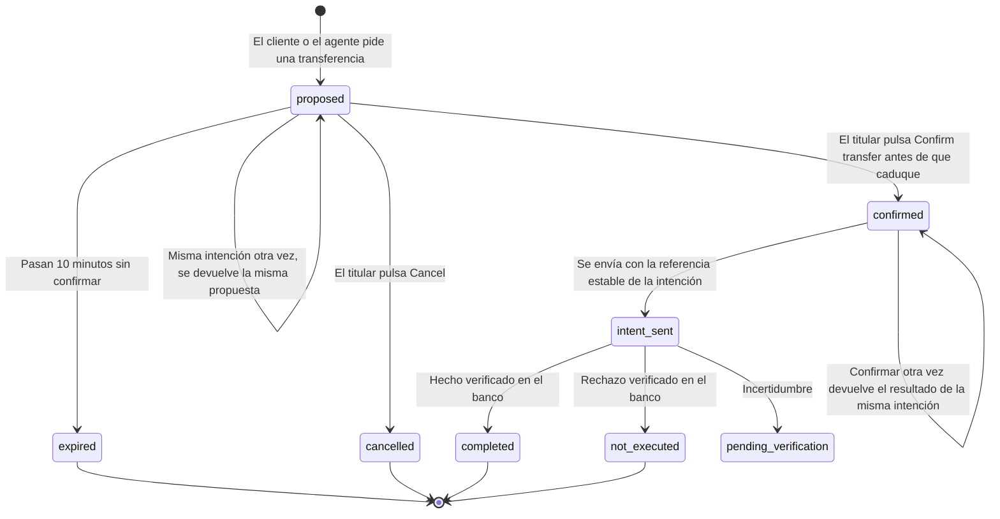

# Fix 2. Revisión explícita antes de ejecutar

- **Estado:** diseño aprobado. Implementación en tres partes: (a) servidor, (b) agente y (c) interfaz.
- **Hallazgos que corrige:** H4 y H5 de `01-diagnosis.md` (regla 3 del contrato). Cubre H14 (cuenta de origen ambigua) y la observación humana O1.
- **Evidencia «antes»:** R5 no cumple en `evidence/after-fix-1-ui.md`: el dinero sale sin confirmación.
- **Principio:** el modelo propone, la persona decide.

## 1. El principio y la confirmación por chat

El modelo nunca autoriza dinero. Puede preparar una propuesta; solo la ejecuta una acción explícita del cliente en la interfaz: un botón sobre un resumen que muestra importe, cuenta de origen con su nombre, destinatario con nombre y cuenta, y descripción.

Esto se garantiza por construcción, no por instrucciones: la herramienta `transfer_money` del agente deja de enviar dinero y pasa a crear propuestas, y el agente no tiene ninguna herramienta para confirmar.

**¿Aceptar también un «sí» escrito en el chat? Decisión: no.**

| A favor | Riesgo |
|---|---|
| Continuidad: el cliente no sale de la conversación. | El modelo tendría que interpretar un «sí», «vale» u «ok» que puede responder a otra pregunta. |
| Canales sin botones (voz, mensajería). | El contrato lo excluye: «An informational conversation alone does not authorize payment» (`docs/contracts.md:7`). |
| | El texto de un documento o de la descripción de una transferencia podría simular un consentimiento. |
| | Un «sí» no está ligado a unos datos exactos: entre la propuesta y la ejecución el modelo podría cambiar importe o destino. |
| | No tiene caducidad ni uso único. |

Si el cliente escribe «sí, confírmalo», el asistente le indica que pulse el botón de la tarjeta de revisión. Un canal sin interfaz necesitaría su propio mecanismo de confirmación ligado a la propuesta; queda fuera de alcance.

## 2. Estados de una propuesta

A partir de `confirmed` manda la máquina de estados de Fix 1 (`01-transfer-integrity.md`): una referencia por intención, consulta antes de afirmar y «pendiente de verificar» ante la duda.

**Confirmar dos veces produce un solo pago**, por dos barreras:

- **Uso único.** La confirmación se consume en una sola operación atómica de base de datos. De dos clics simultáneos solo uno la consume.
- **Referencia estable.** El clic que no la consume trata la propuesta como ya confirmada y devuelve el resultado de esa misma intención. Si el primer envío aún está en curso, cualquier envío usa la misma referencia, y el banco lo trata como el mismo pago.

Una propuesta caducada o cancelada no se reactiva: hay que pedir la transferencia de nuevo.

## 3. Lo que comprueba la confirmación (H5)

`POST /api/approvals/:id/confirm` ejecuta únicamente lo que está guardado en la propuesta. El cuerpo de la petición no se lee.

| Comprobación | Si falla |
|---|---|
| La propuesta existe y es del usuario de la sesión. | 404 «Proposal not found.», igual que antes. No revela si existe para otra persona. |
| La intención asociada es del mismo usuario y sus datos son idénticos a los de la propuesta. | 409. No se envía nada. |
| No está cancelada. | Resultado `cancelled`. No se envía nada. |
| No ha caducado. | Resultado `expired`. No se envía nada. |
| No se ha usado ya. | Se devuelve el resultado de la intención ya confirmada. No se envía de nuevo. |
| La cuenta de origen sigue siendo del titular en el momento de ejecutar. | Resultado «no ejecutada». |

**Caducidad: 10 minutos.** Da tiempo a leer y decidir dentro de una conversación, y es lo bastante corta para que el saldo y el contexto no hayan cambiado y para que una pantalla desatendida no sea un riesgo. La tarjeta muestra la hora de caducidad.

Cambios de datos necesarios: ninguno en el esquema. La tabla `approvals` ya tiene `payload`, `expires_at` y `consumed_at`. La intención gana estados nuevos, entre ellos `proposed` y `cancelled`.

## 4. Cómo se aplica en cada entrada

| Entrada | Antes | Diseño |
|---|---|---|
| Herramienta del chat | `transfer_money` envía el dinero. | `transfer_money` crea una propuesta y devuelve `requires_confirmation`. El asistente explica que no se ha enviado nada y que hay que confirmar en la tarjeta. La tarjeta aparece bajo el chat. |
| Formulario | «Send transfer» envía el dinero. | El botón pasa a ser «Review transfer» y crea la propuesta. La tarjeta de revisión tiene «Confirm transfer» y «Cancel». Tras confirmar, el formulario se vacía (O1). |
| API | `POST /api/actions` devuelve `completed`. | `POST /api/actions` devuelve `requires_confirmation` con la propuesta (`approval.id`, `approval.expiresAt`, datos y resumen). `POST /api/approvals/:id/confirm` ejecuta. |

**Compatibilidad con `docs/contracts.md`.** El diseño usa la superficie ya documentada, sin cambiarla: `POST /api/actions`, `POST /api/approvals/:id/confirm` como «confirmation entry point for proposals», `dashboard.approvals` para mostrarlas, y resultados con `status` y los campos `operation`, `approval` o `error`. Se añade una sola ruta, `POST /api/approvals/:id/cancel`.

**La misma intención otra vez.** Repetir una petición con el mismo `intentId` devuelve la misma propuesta mientras siga viva; si ya se confirmó, devuelve el resultado verificado de Fix 1. Una intención «no ejecutada» que se repite genera una propuesta nueva: ningún envío ocurre sin una confirmación vigente.

**El resultado vuelve a la conversación.** Cuando el cliente confirma una propuesta nacida en el chat, el mensaje de resultado se añade a esa conversación. Sin esto, el chat se quedaría en «por favor, confirma» y ni el cliente ni un operador verían cómo terminó.

**Cuenta de origen (H14).** La tarjeta muestra siempre la cuenta de origen con su nombre. Además, las instrucciones del agente le piden preguntar cuando el cliente tiene varias cuentas y no ha dicho cuál; esa parte depende del modelo, la tarjeta no.

## 5. Cómo encaja D8

Con la confirmación explícita, una petición idéntica deja de retenerse: se convierte en una propuesta con una advertencia, y solo la confirmación del cliente envía un segundo pago.

La advertencia aparece en la tarjeta cuando el cliente tiene otra transferencia con los mismos datos que:

- está pendiente de verificar (antes se concilia con el banco, como en D8), o
- se completó en las últimas 24 horas.

La advertencia se calcula en el momento de mostrar la tarjeta, no al crearla, así que refleja el estado real cuando el cliente decide. Esto cubre también O1: un segundo clic en el formulario tras un pago completado muestra la advertencia en lugar de pagar otra vez.

Este punto modifica D8 y está registrado como D11.

## 6. Lo que lee el cliente

**Tarjeta de revisión**

| Elemento | Inglés | Traducción |
|---|---|---|
| Título | Review your transfer | Revisa tu transferencia |
| Importe | Amount: {amount} | Importe: {importe} |
| Origen | From: {account label} ({masked IBAN}) | Desde: {nombre de la cuenta} ({IBAN enmascarado}) |
| Destino | To: {recipient name} · {recipient account label} ({masked IBAN}) | Para: {nombre del destinatario} · {nombre de su cuenta} ({IBAN enmascarado}) |
| Descripción | Description: {concept} | Descripción: {concepto} |
| Pie | Nothing is sent until you confirm. This proposal expires at {time}. | No se envía nada hasta que confirmes. Esta propuesta caduca a las {hora}. |
| Botones | Confirm transfer · Cancel | Confirmar transferencia · Cancelar |
| Advertencia (pendiente) | You already have an identical transfer being verified (reference {reference}). If you confirm, this will be a second, separate payment. | Ya tienes una transferencia idéntica en verificación (referencia {referencia}). Si confirmas, será un segundo pago distinto. |
| Advertencia (completada) | You already completed an identical transfer at {time} (reference {reference}). If you confirm, this will be a second, separate payment. | Ya completaste una transferencia idéntica a las {hora} (referencia {referencia}). Si confirmas, será un segundo pago distinto. |

**Resultados**

| Situación | Inglés | Traducción |
|---|---|---|
| Propuesta creada (chat y formulario) | We have prepared a transfer of {amount} from {account} to {recipient}. Nothing has been sent yet. Please review it and press Confirm transfer. This proposal expires at {time}. | Hemos preparado una transferencia de {importe} desde {cuenta} a {destinatario}. Todavía no se ha enviado nada. Revísala y pulsa Confirmar transferencia. Esta propuesta caduca a las {hora}. |
| El cliente escribe «sí» en el chat | We cannot confirm a payment from the chat. Please press Confirm transfer on the review card. | No podemos confirmar un pago desde el chat. Pulsa Confirmar transferencia en la tarjeta de revisión. |
| Caducada | This proposal has expired and nothing was sent. If you still want to make the transfer, start it again. | Esta propuesta ha caducado y no se ha enviado nada. Si aún quieres hacer la transferencia, iníciala de nuevo. |
| Cancelada | You cancelled this transfer. Nothing was sent. | Has cancelado esta transferencia. No se ha enviado nada. |
| Confirmada | Los mensajes de Fix 1: completada, no ejecutada o pendiente de verificar. | — |
| Confirmada por segunda vez | El mismo mensaje de resultado que la primera vez. | — |

La frase del «sí» en el chat la redacta el modelo a partir de sus instrucciones; su texto exacto no se puede garantizar.

**La hora la dice la pantalla, no el servidor.** El servidor no conoce la zona horaria del cliente, así que sus mensajes dicen «expires in N minutes» e «in the last 24 hours», y llevan la marca de tiempo exacta como dato. La hora de reloj («at {time}») la muestra solo la tarjeta, calculada en el navegador. Es la tesis aplicada hasta al reloj: el sistema no afirma una hora que no puede conocer.

## 7. Casos de reproducción

| Caso | Historia del cliente | Pasa cuando | ¿Rojo antes del código? |
|---|---|---|---|
| R5 (existente) | Lucía pide una transferencia: ¿puede revisar antes de que salga el dinero? | Sin confirmación no se mueve dinero y la propuesta es visible. | Ya estaba en rojo. |
| R18 | Lucía pulsa confirmar dos veces seguidas: ¿paga una sola vez? | Dos confirmaciones simultáneas y una tercera después: un solo cargo y la misma operación. | Sí |
| R20 | Bruno intenta confirmar la propuesta de Lucía: ¿se le impide? | 404 y ningún cargo; Lucía aún puede confirmarla. | Sí |
| R21 | Alguien altera la confirmación para cambiar importe y destino: ¿se ejecuta lo que Lucía revisó? | Un cargo de 10,00 EUR a Bruno y nada a nadie más. | Sí |
| R22 | Lucía cancela la propuesta y después llega una confirmación: ¿se envía algo? | Ningún cargo. | Sí |
| R15 (se reescribe, D11) | Con un pago pendiente de verificar, Lucía pide otro idéntico: ¿se le avisa antes de pagar dos veces? | La segunda petición no mueve dinero por sí sola y su propuesta lleva la advertencia. | Sí, con la comprobación nueva |

No existe R19: el número quedó reservado para la propuesta caducada, que se prueba en `tests/`.

**Propuesta caducada: prueba en `tests/`, no en el script.** Esperar 10 minutos reales no es viable, y el script solo puede leer la base de datos (D7), así que no puede adelantar la caducidad. Una prueba con base de datos temporal crea una propuesta ya caducada y comprueba que confirmarla no envía nada.

Dos límites de esta evidencia:

- **R18, R20, R21 y R22 fallan antes del código por el mismo motivo que R5:** entonces no existe ninguna propuesta que confirmar. Registrarlos en rojo documenta el orden, pero su valor real es como vigilancia después.
- **H5 no se puede reproducir antes del código.** El punto de confirmación original es inalcanzable porque nada crea propuestas; su evidencia es la lectura del código (`app/api/[...path]/route.ts:135-156` en el estado inicial).

## 8. Riesgos de regresión (segundo orden)

**Cómo siguen funcionando R1-R17.** El script ya confirma por el cliente: su función de envío sigue un `requires_confirmation` llamando a `POST /api/approvals/:id/confirm`. Cada caso pasa a ser «pedir y confirmar», y todo lo de Fix 1 ocurre después de la confirmación.

| Caso | Qué cambia | Riesgo |
|---|---|---|
| R1, R3, R7, R14, R17 | Pedir, confirmar y verificar. | Bajo. |
| R2 | El segundo y el tercer pago idénticos llevan advertencia, pero se confirman. | Bajo: deben seguir siendo tres cargos. |
| R4 | La segunda petición con el mismo `intentId` devuelve el resultado completado, no una propuesta nueva. | Medio: es la interacción más delicada entre Fix 1 y Fix 2. |
| R13, R16 | La primera confirmación queda pendiente; lo demás, igual. | Medio. |
| R15 | Cambia su comprobación (sección 7 y D11). | Es un cambio de criterio, no una regresión. |
| R8, R10 | Sin cambios. | — |

**Otros riesgos**

| Riesgo | Mitigación |
|---|---|
| Un evaluador externo que espere `completed` directamente de `POST /api/actions` recibirá `requires_confirmation`. | Es lo que exige la regla 3 y lo que la interfaz original ya contemplaba. La superficie de confirmación es la documentada. Es el mayor cambio visible desde fuera y se asume. |
| El modelo dice «hecho» cuando solo ha propuesto. | El resultado de la herramienta dice que no se ha enviado nada, y la lista de transferencias de la conversación (D9) incluirá «propuesta, sin enviar». Depende del modelo; se comprueba en la prueba humana. |
| Propuestas antiguas acumuladas en la tarjeta tras editar el formulario. | Cada tarjeta muestra sus datos y tiene «Cancel»; caducan solas a los 10 minutos. |
| La conciliación de Fix 1 trata una propuesta sin confirmar como una transferencia sin verificar. | Una propuesta nunca se ha enviado: la conciliación solo mira intenciones enviadas. Se añade una prueba. |
| Una intención «no ejecutada» repetida ya no se reenvía sola. | Cambio deliberado respecto a Fix 1: ahora genera una propuesta nueva. |
| La advertencia de pago idéntico molesta en pagos repetidos legítimos. | Es solo un aviso; no bloquea. |

**Prueba de aceptación humana.** Tras Fix 2 se repiten las secciones C y D del chat y se añaden: el flujo del formulario con revisión (O1), el «sí» escrito en el chat, y el caso de Elena de los datos iniciales («Before deciding whether to send EUR 25 to Hugo, what would I need to review?»), que no debe mover dinero.
