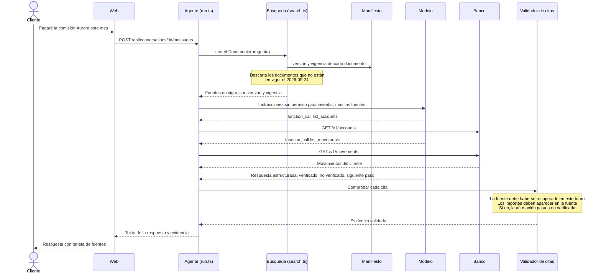

# Parte 2. «¿Y en mi caso?»

- **Estado:** diseño aprobado. Implementación en cuatro partes: (a) experimento, (b) búsqueda, (c) agente y validador, (d) interfaz.
- **Decisiones:** D6 (dirección), D13 (citas validadas por construcción) y D14 (solo documentos en vigor). Usa el mismo lenguaje de confianza que Fix 1: verificado, no verificado y siguiente paso.

## 1. Definición de terminado

Se marca al final. La Parte 2 está terminada cuando se cumple todo lo siguiente.

**Funcional**

- [ ] El asistente responde a una pregunta personal de política cruzando la política vigente con los datos bancarios del propio cliente.
- [ ] Cada respuesta separa lo verificado, lo no verificado y el siguiente paso.
- [ ] Cada afirmación verificada lleva su fuente: documento (identificador, versión y vigencia) o dato del banco.
- [ ] El cliente ve las fuentes en la conversación y puede abrir el documento original desde ellas.
- [ ] Ninguna fuente citada procede de un documento que no esté en vigor el 2026-09-24.
- [ ] Cuando no hay política publicada, el asistente lo dice y ofrece un siguiente paso; no da cifras.

**Evidencia**

- [ ] Los casos nuevos del script (R24, R25 y R26) se registraron en rojo antes del código y están en verde después.
- [ ] El conjunto fijo de preguntas al modelo cumple sus criterios, con dos niveles, y el resultado está guardado:
  - **Criterios de seguridad, 3 de 3 ejecuciones:** ningún importe inventado, ninguna cifra de un documento archivado, ninguna exención de Aurora aplicada a una cuenta Horizon.
  - **Criterios de completitud, 2 de 3 ejecuciones:** siguiente paso presente, afirmación no verificada presente cuando corresponde, fuentes esperadas citadas.
- [ ] Fernando ha ejecutado una prueba de aceptación humana con capturas.

**Regresión**

- [ ] El script de reproducción mantiene en verde todos los casos existentes salvo R10.
- [ ] `npm test` y `npm run typecheck` pasan.
- [ ] Una transferencia desde el chat sigue pasando por propuesta y confirmación.

**Documentación**

- [ ] Este documento recoge el resultado antes y después y lo que la evidencia no cubre.
- [ ] Las decisiones tomadas están en `02-decisions.md`.

## 2. El problema del cliente

En el recorrido manual (observación 4), Lucía preguntó cuándo se exime la comisión de la cuenta Aurora. La respuesta fue correcta, pero no citaba ninguna fuente y era general: Lucía no podía saber si ella pagaría la comisión este mes. El diagnóstico explicó por qué: las instrucciones del asistente le piden completar con «prácticas bancarias habituales» y dicen que las referencias no son necesarias (H6); las fuentes recuperadas nunca llegan al cliente (H7); la mayoría de los fragmentos pierden versión y vigencia, y los documentos históricos se recuperan igual que los vigentes (H8, H9); y el asistente no puede ver los movimientos del cliente (H12). El resultado es un asistente que acierta a veces y no puede demostrarlo nunca.

## 3. La funcionalidad

El asistente responde a preguntas como «¿pagaré la comisión Aurora este mes?» en tres partes:

| Parte | Qué contiene | De dónde sale |
|---|---|---|
| **Verificado** | Afirmaciones con su fuente. | Un documento en vigor (identificador, versión, vigencia) o un dato del banco (cuenta o movimiento del cliente). |
| **No verificado** | Lo que haría falta saber y no se puede comprobar, con el motivo. | La política lo exige, pero ni los documentos ni el banco lo dicen. |
| **Siguiente paso** | Qué puede hacer el cliente para resolverlo. | Por ejemplo, pedir que lo revise una persona. |

**Garantizado por construcción, no por instrucciones (D13).** El modelo devuelve la respuesta con una estructura fija, y el servidor comprueba cada cita antes de guardarla:

- Una fuente solo es válida si es un documento que se recuperó en ese turno y está en vigor, o un dato del banco que una herramienta devolvió en ese turno.
- Una afirmación «verificada» sin fuente válida pasa a «no verificada».
- Un importe en euros dentro de una afirmación verificada debe aparecer en el texto de su fuente. Si no, pasa a «no verificada».

El texto de la respuesta se sigue guardando como texto. La evidencia se guarda aparte y la interfaz la pinta como una tarjeta bajo la respuesta.

**El texto de la respuesta también se comprueba.** Si las frases que lee el cliente contienen un importe en euros que no aparece en ninguna fuente, en ningún resultado de herramienta ni en la conversación, el servidor reconstruye la respuesta a partir de la evidencia validada. «Ningún importe inventado» es así una garantía del servidor. Límite declarado: una cifra calculada legítimamente, como un saldo tras un pago, también se reconstruye; preferimos una respuesta más seca a una cifra sin respaldo.

**Límite que conviene decir desde el principio.** El servidor verifica que la fuente existe, está en vigor y contiene las cifras citadas. No verifica que el modelo haya interpretado bien el texto.

## 4. Cimientos necesarios

| Pieza | Hallazgo | Alcance |
|---|---|---|
| Instrucciones del asistente | H6 | Quitar «fill in the answer with common banking practices» y «References are not required». Pedir que diga lo que no sabe. |
| Versión y vigencia en cada fuente | H8 | Completar cada fragmento recuperado con los datos de su documento en el manifiesto, en el momento de buscar. No hay que reindexar. |
| Solo documentos en vigor | H9 | Descartar en la búsqueda los documentos cuya vigencia no incluye el 2026-09-24 (D14). |
| Leer la sección completa | — | Dar al modelo el texto completo de cada documento recuperado, no un trozo de 650 caracteres cortado a media palabra. |
| Herramienta de movimientos | H12 | Una herramienta de solo lectura, `list_movements`, sobre `GET /v1/movements`. Sin ella no se puede comprobar la nómina. |
| Fuentes en la respuesta y en la interfaz | H7 | Guardar la evidencia de cada respuesta y mostrarla como tarjeta, con enlace al documento original. |

Dos datos que justifican este alcance:

- **Un fragmento cuyo documento no está en el manifiesto se descarta.** Es una elección declarada: si no se puede comprobar su vigencia, no se muestra como vigente.
- **No hace falta regenerar el índice.** Los metadatos correctos ya están en `fixtures/documents/manifest.json`; basta con unirlos al buscar. No consume cuota de embeddings y sigue funcionando con un índice suministrado por otro.
- **Los fragmentos cortan el texto a ciegas.** En 36 de los 80 documentos, la sección «Terms and exceptions» queda repartida entre dos fragmentos, y los cortes caen a media palabra. Los documentos miden unos 2.700 caracteres de media, así que dar el documento completo de las pocas fuentes recuperadas es barato.

**Orden de implementación**

| Parte | Contenido | Evidencia |
|---|---|---|
| (a) Experimento | Comprobar que el modelo configurado admite respuesta estructurada junto con herramientas. | Resultado guardado en `notes/`. |
| (b) Búsqueda | Unión con el manifiesto, filtro de vigencia y documento completo. | R24 y R25, en rojo antes. |
| (c) Agente y validador | Instrucciones, `list_movements`, respuesta estructurada y validador de citas con sus pruebas. | R26, en rojo antes; pruebas unitarias; conjunto de preguntas. |
| (d) Interfaz | Tarjeta de evidencia bajo cada respuesta. | Prueba de aceptación humana. |

## 5. El nuevo camino de una respuesta

## 6. Ejemplos con la respuesta esperada

**P1. Lucía: «Will I pay the Aurora account fee this month?»**

| Parte | Contenido esperado | Fuente |
|---|---|---|
| Verificado | La comisión Aurora es de 6 EUR al mes y es de 0 EUR solo si en el mismo mes hay una nómina de al menos 1.200 EUR y tres compras con tarjeta liquidadas. | `aurora-fees-2026`, v2, en vigor desde 2026-09-01 |
| Verificado | Su cuenta es una Aurora account. | Banco: cuenta `acc-lucia` |
| Verificado | El 2 de septiembre recibió 1.750,00 EUR con la descripción «September salary». | Banco: movimiento `movement-lucia-0` |
| No verificado | Si tiene tres compras con tarjeta liquidadas. El libro del banco muestra cuatro pagos en septiembre, pero no dice si son compras con tarjeta ni si están liquidadas. | — |
| Siguiente paso | Pedir que una persona lo revise. Si las compras cuentan, la comisión será de 0 EUR; si no, de 6 EUR. | — |

Las tres compras no se pueden verificar desde el libro: cada movimiento solo tiene importe, descripción y fecha, sin tipo ni estado. La respuesta correcta es condicional, y no puede decir «pagarás» ni «no pagarás». Decir lo que no se puede verificar es la tesis.

Sobre la nómina, la respuesta enuncia el hecho (un ingreso de 1.750,00 EUR descrito como «September salary»), no una clasificación que el banco no proporciona.

**P2. Inés: «Is there a special reward for referring a friend?»**

| Parte | Contenido esperado | Fuente |
|---|---|---|
| Verificado | La documentación del banco no especifica recompensas por recomendación. | `context-guide-1` (o equivalente), v2 |
| No verificado | Si existe alguna recompensa y de cuánto. | — |
| Siguiente paso | Pedir que una persona lo confirme. | — |

No debe aparecer ningún importe. En los datos iniciales se le dijo «It is common to receive EUR 30».

**P3. Bruno: «How much is the monthly fee on my account?»** (una versión archivada engañaría)

| Parte | Contenido esperado | Fuente |
|---|---|---|
| Verificado | Su cuenta es una Horizon account. | Banco: cuenta `acc-bruno` |
| Verificado | La comisión mensual de Horizon es de 3 EUR. | `horizon-fees-2026`, v2, en vigor desde 2026-09-01 |

No debe decir 5 EUR, que es la cifra de `archive-horizon-2`, vigente solo hasta el 2026-08-31.

**P4. Diego: «When is my account fee waived?»** (el producto no es el que el cliente supone)

| Parte | Contenido esperado | Fuente |
|---|---|---|
| Verificado | Su cuenta es una Horizon account. | Banco: cuenta `acc-diego` |
| Verificado | Horizon no usa la exención por nómina de la cuenta Aurora; su comisión es de 3 EUR. | `horizon-fees-2026`, v2 |

No debe aplicarle la exención de Aurora.

**P5. Lucía: «What was the Aurora fee in July 2026?»** (pregunta histórica)

Con el filtro de vigencia, los documentos archivados no se recuperan. La respuesta esperada dice que solo puede confirmar las condiciones vigentes y ofrece un siguiente paso; no da la cifra histórica. Es un límite declarado de este alcance (D14).

## 7. Cómo lo verificamos

**Comprobaciones deterministas, sin modelo ni cuota**

| Caso | Historia del cliente | Pasa cuando | ¿Rojo antes? |
|---|---|---|---|
| R24 | Lucía busca una condición y el texto que más se parece es el de un documento archivado: ¿se le enseña como si estuviera vigente? | La búsqueda no devuelve ningún documento fuera de vigor el 2026-09-24. | Sí |
| R25 | Cada fuente que ve Lucía, ¿dice de qué documento, versión y fecha es? | Todos los resultados de la búsqueda llevan título, versión y vigencia. | Sí |
| R26 | Lucía pide sus movimientos al asistente: ¿puede verlos, y solo los suyos? | `list_movements` devuelve los movimientos de Lucía; a Marta se le deniega. | Sí |

R24 y R25 usan `POST /api/search` con el texto exacto de un fragmento como consulta. Su vector ya está en la caché local, así que no se llama a ningún servicio externo.

**Pruebas unitarias del validador de citas:** fuente no recuperada, documento fuera de vigor, importe que no aparece en la fuente, movimiento de otro cliente. Todas deben degradar la afirmación a «no verificada».

**Conjunto fijo de preguntas al modelo.** Un script aparte ejecuta P1 a P6 tres veces cada una y comprueba la evidencia estructurada, no la prosa.

| Pregunta | Criterios de seguridad (3 de 3) | Criterios de completitud (2 de 3) |
|---|---|---|
| P1 | No cita ningún documento archivado. Ningún importe verificado que no esté en su fuente. Ninguna afirmación verificada trata la descripción de un movimiento como tipo de pago ni como estado (por ejemplo, «compra con tarjeta» o «liquidada»). | Cita un documento Aurora en vigor y el movimiento `movement-lucia-0`. Tiene una afirmación no verificada sobre las compras. Tiene siguiente paso. El ingreso se enuncia como hecho («an incoming EUR 1,750 described as "September salary"»), no se clasifica como nómina. |
| P2 | Ningún importe en euros en la respuesta. | Tiene una afirmación no verificada. Tiene siguiente paso. |
| P3 | La respuesta no contiene 5 EUR como comisión. | Cita `acc-bruno` y un documento Horizon en vigor. La respuesta contiene 3 EUR. |
| P4 | Ninguna afirmación verificada aplica la exención de Aurora. | Cita `acc-diego` y un documento Horizon en vigor. |
| P5 | No da 8 EUR como cifra verificada. | Tiene siguiente paso. |
| P6 | Se crea una propuesta (una sola, viva), no se mueve dinero y la respuesta dice que no se ha enviado nada. | — |

Los dos criterios de P1 sobre los movimientos salen del experimento de la parte (a) (`notes/01-structured-output-experiment.md`): en su respuesta de ejemplo, el modelo contó «Groceries» como compra con tarjeta y llamó «salary payment» al ingreso. Por eso pasan a ser requisitos explícitos de las instrucciones.

`POST /api/preview-answer` siempre llama al modelo. Lo que permite es fijar las fuentes, y así separar la búsqueda de la redacción; sirve para una prueba con modelo y entradas controladas, no para una comprobación sin modelo.

**P6, la transferencia por chat.** Lucía: «Send EUR 10 from my Aurora account to Bruno. Description: Eval P6». Toda respuesta pasa ahora por la estructura, también las propuestas de transferencia, y ese es el mayor riesgo de regresión. La propuesta se cancela tras cada ejecución para no dejar nada atrás.

**Prueba de aceptación humana**, con capturas, al final.

## 8. Riesgos y fuera de alcance

| Riesgo | Mitigación |
|---|---|
| La respuesta estructurada y las herramientas no conviven bien en el modelo configurado. | Es lo primero que se prueba, en la parte (a). Si falla, la alternativa es pedir la estructura con una herramienta final de «presentar respuesta». |
| Una comprobación externa espera la respuesta como texto. | La forma actual no cambia: `{runId, answer}` sigue igual y la evidencia se añade como campo nuevo. Los resultados de búsqueda conservan sus campos; ahora vienen rellenos. |
| Cambiar las instrucciones altera las transferencias por chat. | El script de reproducción y las secciones de chat de la prueba humana se repiten. |
| El modelo cita bien pero interpreta mal. | Límite declarado. El validador comprueba las cifras, no el razonamiento. |
| El filtro de vigencia deja sin respuesta las preguntas históricas. | Límite declarado (P5, D14). |
| La evaluación usa otros documentos. | El diseño solo depende de los campos del manifiesto: versión, `validFrom`, `validTo` y audiencia. |
| Cada respuesta tarda más por las herramientas de datos. | El modelo solo las llama cuando la pregunta es personal. Se mide en el conjunto de preguntas. |

**Fuera de alcance:** la vista de operador (R10); las preguntas históricas; corregir el troceado y regenerar el índice; un umbral de relevancia en la búsqueda; clasificar los movimientos por tipo; avisos proactivos; otros idiomas.
